# IChop.jl 

## Installation

Install the development version of `IChop` from GitHub
(Julia ≥ 1.9):

```julia
using Pkg
Pkg.add(url = "https://github.com/yuchenxiao95/IChop.jl")
```

The same methods are available in R through the package
[IChop](https://github.com/yuchenxiao95/IChop), which
calls this Julia code.

## Overview

IChop addresses the computational barrier of solving
$\ell_0$-penalized regression in linear models where the number of
predictors $p$ is large, in the hundreds or even the thousands, yet smaller
than the number of observations $n$. Finding the optimal solution of
$\ell_0$-penalized regression has been treated as a combinatorial problem
that requires discrete optimization and is NP-hard. This package builds on a
connection with Hopfield networks, which are used for associative memory
retrieval ([Xiao and Walker, 2026](https://doi.org/10.1007/s11222-026-10853-5)).
It makes generalized information criteria (GIC;
[Kim, Kwon and Choi, 2012](https://jmlr.org/papers/v13/kim12a.html)) for variable selection,
which are equivalent to $\ell_0$-penalized regression, computationally
feasible. The rationale is that there remains strong interest in GIC, whose
statistical properties are superior to those of $\ell_1$-based
regularization.

### The Hopfield network

A Hopfield network (Hopfield, 1982) is a model of associative memory with $p$
neurons, each connected to every other neuron by undirected edges with no
self-connections. The state $z \in \lbrace 1, -1 \rbrace^p$ evolves through a
symmetric weight matrix $W$, built from a stored pattern $z_s$ by Hebb's law,
$W = z_s^\top z_s - I$, so that $W_{ij} = W_{ji} = z_i z_j$ and $W_{ii} = 0$.
The network updates one neuron at a time,

$$
z_i(t+1) = \mathrm{sgn}\big(H_i(t)\big), \qquad
H_i(t) = \sum_{j \ne i} w_{ij} z_j(t),
$$

with $\mathrm{sgn}(H) = 1$ if $H \ge 0$ and $-1$ otherwise, cycling
through $i = 1, \dots, p$ until $z$ is stable. Each update can only lower the
energy

$$
E(z) = -z^\top W z ,
$$

and $E$ is bounded below, so the network always converges to a locally stable
state (Bruck, 1990).

### Connection with AIC

Write the linear model with inclusion indicators $z_j \in \lbrace 0, 1 \rbrace$:

$$
y_i = \sum_{j=1}^{p} x_{ij} z_j \beta_j + \sigma \varepsilon_i ,
\qquad\text{or}\qquad
y = X D_t^p \beta + \sigma \varepsilon ,
$$

where $D_t^p = \mathrm{diag}(z_1, \dots, z_p)$ has $t$ nonzero entries, so
$X_t = X D_t^p$ holds the true predictors. For a candidate model
$X_d = X D_d^p$ with hat matrix $H_d = X_d (X_d^\top X_d)^{-1} X_d^\top$, AIC
is an asymptotically unbiased estimate of

$$
\frac{1}{n} \beta^\top X_t^\top H_d X_t \beta
= \frac{1}{n} \langle X_t \beta, X_t \beta \rangle_{H_d}
= \frac{1}{n} \langle X_t \beta, \widehat{X_t \beta} \rangle ,
$$

where $\widehat{X_t \beta} = H_d X_t \beta$. Maximizing it minimizes the
expected out-of-sample error and finds the optimal orthogonal projection onto
the span of $X_t \beta$, reached when $X_d = X_t$. This quantity plays the
role of the energy term in a Hopfield network and allows the indicators to be
updated one at a time:

$$
z_j(t+1) = \mathbf{1}\left\lbrace
\frac{1}{n} \beta^\top X_t^\top H_{d+1} X_t \beta >
  \frac{1}{n} \beta^\top X_t^\top H_d X_t \beta \right\rbrace ,
$$

where $H_{d+1}$ includes $x_j$. Under these updates the energy term is
nondecreasing and bounded above by
$\frac{1}{n} \beta^\top X_t^\top X_t \beta$. The true signal is unknown, but it
is linked to the data through

$$
\frac{1}{n} \beta^\top X^\top H_d X \beta
= \mathbb{E}\left[ \frac{1}{n} y^\top H_d y \right] - d \frac{\sigma^2}{n}
\xrightarrow{p} \mathbb{E}\left[ \beta^\top X^\top H_d X \beta \right] .
$$

Replacing the unknown signal with the data gives the update rule for AIC,

$$
z_j(t+1) = \mathbf{1}\left\lbrace
\frac{1}{n} y^\top H_{d+1} y - 2(d+1) \frac{\sigma^2}{n} >
  \frac{1}{n} y^\top H_d y - 2d \frac{\sigma^2}{n} \right\rbrace ,
$$

and, for any GIC with penalty $p(n, d)$,

$$
z_j(t+1) = \mathbf{1}\left\lbrace
\frac{1}{n} y^\top H_{d+1} y - p(n, d+1) >
  \frac{1}{n} y^\top H_d y - p(n, d) \right\rbrace .
$$

This establishes a connection between the expected out-of-sample MSE and the
energy function of the Hopfield network for associative memory, where the
stable local minima in the energy function of the Hopfield network correspond
to optimal sparse solutions.

AIC is minimax-rate optimal but inconsistent when a true model exists;
criteria with stronger penalties achieve consistency. Table 1 lists the
criteria in the package and their penalties $p(n, d)$, where $d$ is the number
of selected variables and $P$ the number of candidate predictors:

| Name | $p(n, d)$ | Reference |
|:--|:--|:--|
| AIC | $2d \frac{\sigma^2}{n}$ | [Akaike (1974)](https://doi.org/10.1109/TAC.1974.1100705) |
| BIC | $d \frac{\sigma^2}{n} \log n$ | [Schwarz (1978)](https://doi.org/10.1214/aos/1176344136) |
| GIC2 | $d \frac{\sigma^2}{n} P^{1/3}$ | [Kim et al. (2012)](https://jmlr.org/papers/v13/kim12a.html) |
| GIC3 | $2d \frac{\sigma^2}{n} \log P$ | [Kim et al. (2012)](https://jmlr.org/papers/v13/kim12a.html) |
| GIC4 | $2d \frac{\sigma^2}{n} (\log P + \log\log P)$ | [Kim et al. (2012)](https://jmlr.org/papers/v13/kim12a.html) |
| GIC5 | $d \frac{\sigma^2}{n} \log\log n \log P$ | [Kim et al. (2012)](https://jmlr.org/papers/v13/kim12a.html) |
| GIC6 | $d \frac{\sigma^2}{n} \log n \log P$ | [Kim et al. (2012)](https://jmlr.org/papers/v13/kim12a.html) |
| CAIC | $d \frac{\sigma^2}{n} (\log n + 1)$ | [Bozdogan (1987)](https://doi.org/10.1007/BF02294361) |
| CAICF | $d \frac{\sigma^2}{n} (\log n + 1) + \frac{\sigma^2}{n} \log\det(X_d^\top X_d / \sigma^2)$ | [Bozdogan (1987)](https://doi.org/10.1007/BF02294361) |
| SIC | $d \frac{\sigma^2}{n} \sqrt{n}$ | [Shao (1997)](https://www3.stat.sinica.edu.tw/statistica/j7n2/j7n21/j7n21.htm) |
| AICc | $(d + 1) \frac{\sigma^2}{n - d - 2}$ | [Hurvich and Tsai (1989)](https://doi.org/10.1093/biomet/76.2.297) |
| EBIC | $d \frac{\sigma^2}{n} \left(\log n + \gamma \log \binom{P}{d}\right)$, $\gamma = 0.6$ by default | [Chen and Chen (2008)](https://doi.org/10.1093/biomet/asn034) |

## Examples

The examples below compare three IC on the same data. In increasing
order of penalty per variable, they are AIC ($c_n = 2$), BIC ($\log n$) and
GIC6 ($\log n \log P$), where $P$ is the number of candidate
predictors. Each example also runs the Boltzmann machine
with GIC6, which uses probabilistic updates instead of the deterministic
updates of a standard Hopfield network. The Boltzmann machine accepts a move
that lowers the criterion by $\Delta$ with probability $1/(1 + e^{\Delta/T})$,
where the temperature $T$ is a tuning parameter. The Boltzmann machine can
leave a local optimum and provide some uncertainty quantification. Every example
uses the default $T = 0.1$.

For reference, the examples also fit the lasso and the adaptive lasso with
[GLMNet.jl](https://github.com/JuliaStats/GLMNet.jl), tuned by 10-fold
cross-validation (the $\lambda$ with the smallest cross-validated loss); the
adaptive lasso uses weights from a ridge pilot fit.

The search is run by

```
GIC_Variable_Selection(X, Y, init_cols, Calculate_GIC, Calculate_GIC_short, k; Nsim)
```

where `Calculate_GIC_short` is the matching `Calculate_<name>_short` function,
kept for backward compatibility and not used by the search. It starts from
the columns `init_cols` and visits every column in random
order `Nsim` times, adding it if it is absent and removing it if it is
present, whenever this increases the criterion. Models stay below `k`
variables. It returns a tuple with the criterion value, the selected columns
and the elapsed time after each step. `GIC_Variable_Selection_Boltzmann()`
takes the same arguments, with `k` and `Nsim` as keywords.

Each table reports the size, false positives and false negatives of the
selected model, and the wall-clock time of each method in seconds (Apple M1
Pro laptop, Julia 1.11, after Julia has compiled). Three figures follow each
table: the criterion along the search, the model size along the search, and
the same run times as the table.

<!-- Helper functions used in the examples (hidden; run by docs/readme_figures.jl)

```julia
using Random, LinearAlgebra
using GLMNet, Distributions          # lasso and adaptive lasso

criteria = (AIC  = (Calculate_AIC, Calculate_AIC_short),
            BIC  = (Calculate_BIC, Calculate_BIC_short),
            GIC6 = (Calculate_GIC6, Calculate_GIC6_short))
sample_sizes = (n1000 = 1000, n2000 = 2000)

first_rows(Y, n) = Y isa AbstractMatrix ? Y[1:n, :] : Y[1:n]

# Call `f()` and attach its wall-clock time in seconds
function timed(f)
    seconds = @elapsed fit = f()
    merge(fit, (seconds = seconds,))
end

# Criterion value and selected columns after each step of a search
search_path(fit) = (values = fit[1], models = fit[2])

# Coefficients at the lambda with the smallest cross-validated loss, one
# column per response
function lasso_coef(cv)
    b = cv.path.betas
    i = argmin(cv.meanloss)
    ndims(b) == 3 ? b[:, :, i] : reshape(b[1:size(b, 1), i], :, 1)
end

# Lasso, or adaptive lasso with ridge pilot weights, tuned by 10-fold
# cross-validation. A predictor is selected if any response (or category) has
# a nonzero coefficient. The multinomial lasso is ungrouped (GLMNet.jl's
# grouped fit is about 20 times slower here), and its lambda path stops at
# 1% of the largest lambda: further down, glmnet can fail to converge.
# docs/readme_figures.jl loads docs/glmnet_patch.jl first, which fixes how
# GLMNet.jl 0.7.4 returns multi-response and multinomial coefficients.
function fit_lasso(X, y, family; adaptive = false)
    kw = (folds = [mod1(i, 10) for i in 1:size(X, 1)],)
    family isa Multinomial && (kw = (kw..., lambda_min_ratio = 0.01))
    if adaptive
        ridge = glmnetcv(X, y, family; alpha = 0.0, kw...)
        kw = (kw..., penalty_factor = 1 ./ vec(sqrt.(sum(abs2, lasso_coef(ridge); dims = 2))))
    end
    cv = glmnetcv(X, y, family; kw...)
    (selected = findall(vec(any(lasso_coef(cv) .!= 0; dims = 2))),)
end

# For each n, run the search once per criterion on the first n observations,
# then the Boltzmann search with GIC6, and the lasso and adaptive lasso on the
# original response `lasso_y`
compare_criteria(X, Y, init, k; Nsim, lasso_y = Y, lasso_family = Normal()) =
    map(sample_sizes) do n
        Xn, Yn, yn = X[1:n, :], first_rows(Y, n), first_rows(lasso_y, n)
        gic = map(criteria) do crit
            timed(() -> search_path(GIC_Variable_Selection(Xn, Yn, init, crit..., k; Nsim = Nsim)))
        end
        merge(gic, (
            Boltzmann = timed(() -> search_path(GIC_Variable_Selection_Boltzmann(
                Xn, Yn, init, Calculate_GIC6, Calculate_GIC6_short; k = k, Nsim = Nsim))),
            Lasso    = timed(() -> fit_lasso(Xn, yn, lasso_family)),
            AdaLasso = timed(() -> fit_lasso(Xn, yn, lasso_family; adaptive = true))))
    end

last_model(fit) = sort(fit.models[end])

# Size, false positives, false negatives and run time of each final model
struct SelectionTable
    rows::Vector{String}
    stats::Matrix{Int}
    seconds::Vector{Float64}
end

function selection_table(fits, truth)
    rows, stats, seconds = String[], Vector{Int}[], Float64[]
    for (n, by_method) in pairs(fits), (method, fit) in pairs(by_method)
        s = haskey(fit, :selected) ? fit.selected : last_model(fit)
        push!(rows, "$n $method")
        push!(stats, [length(s), length(setdiff(s, truth)), length(setdiff(truth, s))])
        push!(seconds, fit.seconds)
    end
    SelectionTable(rows, permutedims(reduce(hcat, stats)), seconds)
end

function Base.show(io::IO, ::MIME"text/plain", t::SelectionTable)
    w = maximum(length, t.rows)
    print(io, " "^w, "  size false_pos false_neg seconds")
    for (r, s, sec) in zip(t.rows, eachrow(t.stats), t.seconds)
        print(io, "\n", rpad(r, w), lpad(s[1], 6), lpad(s[2], 10), lpad(s[3], 10),
              lpad(string(round(sec, digits = 2)), 8))
    end
end

# Compile everything once, so the run times exclude Julia's compilation
function warm_up()
    Xw = randn(2000, 20)
    yw = Xw[:, 1] + randn(2000)
    compare_criteria(Xw, yw, 1:5, 20; Nsim = 1)
    compare_criteria(Xw, [yw yw], 1:5, 20; Nsim = 1, lasso_family = MvNormal())
    counts = rand(0:10, 2000)
    for (y, family) in ((counts, Poisson()), ([10 .- counts counts], Binomial()),
                        (Float64[mod1(i, 3) == j for i in 1:2000, j in 1:3], Multinomial()))
        fit_lasso(Xw, y, family); fit_lasso(Xw, y, family; adaptive = true)
    end
end
warm_up();
```

Each figure shows, for every criterion, its value and the number of selected
variables after each search step: solid lines for $n = 1000$ and dotted lines
for $n = 2000$. Light grey vertical lines mark a new pass over the
predictors, and the dashed line marks the true model size. Criteria with
larger penalties take lower values, so compare the shapes of the curves, not
their heights. The lasso and adaptive lasso have no search path; squares at
the right edge of the model-size figure mark their model sizes (light: $n = 1000$,
dark: $n = 2000$). The script
[`docs/readme_figures.jl`](docs/readme_figures.jl) runs the code in this
section and redraws the figures.
-->

All examples use the same setting. The design matrix $X$ has $n = 2000$
observations of $p = 500$ independent standard normal predictors, so the
predictor covariance is $\Sigma = I$, and only a few predictors affect the
response. Every search runs twice, on the first 1000 observations and on all
2000.

The examples below highlight some well-known statistical properties of these
criteria:

1. In linear regression, AIC is minimax-rate optimal and BIC is consistent.
   In the linear model figure, AIC (blue line) attains the minimax optimality
   at the expense of many false positives.
2. Criteria in the GIC family achieve consistency at different rates. In the
   linear model figure, GIC6 (green line) reaches the true model within two
   passes of the search, and achieves consistency at a faster rate than BIC
   (orange line).
3. Consistency is an asymptotic result. Doubling the sample size (dotted
   lines) improves the rate of consistency.

### Linear model

Here the response is $Y = X\beta + \varepsilon$ with
$\varepsilon \sim N(0, \sigma^2 I)$. Five randomly chosen coefficients equal
2 and the rest are 0, and $\sigma^2$ gives a signal-to-noise ratio of
$\beta^\top\Sigma\beta/\sigma^2 = 0.71$. Every search starts from the full
model:

```julia
Random.seed!(1)
n, p = 2000, 500
X = randn(n, p)
true_cols = sort(randperm(p)[1:5])
beta = zeros(p); beta[true_cols] .= 2
Y = LP_to_Y(X, beta, "Normal"; std = sqrt(sum(abs2, beta) / 0.71))

fits = compare_criteria(X, Y, 1:p, p; Nsim = 5)
selection_table(fits, true_cols)
#>                  size false_pos false_neg seconds
#> n1000 AIC         119       114         0    0.32
#> n1000 BIC          10         5         0    0.17
#> n1000 GIC6          5         0         0    0.15
#> n1000 Boltzmann     5         0         0    0.24
#> n1000 Lasso        11         6         0     2.1
#> n1000 AdaLasso     44        39         0    4.81
#> n2000 AIC          97        92         0    0.31
#> n2000 BIC          10         5         0    0.34
#> n2000 GIC6          5         0         0    0.23
#> n2000 Boltzmann     7         2         0    0.32
#> n2000 Lasso        23        18         0    2.81
#> n2000 AdaLasso     39        34         0    7.89
```

<p align="center">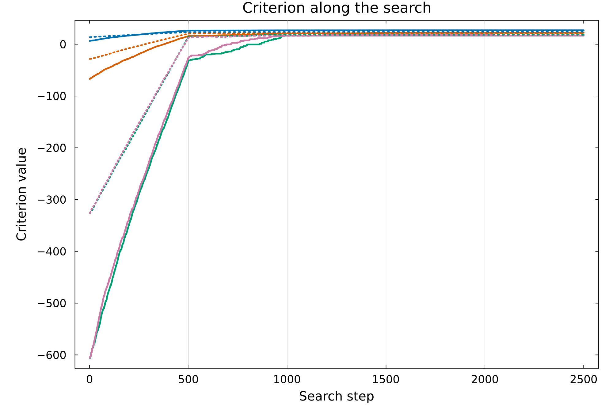</p>

<p align="center">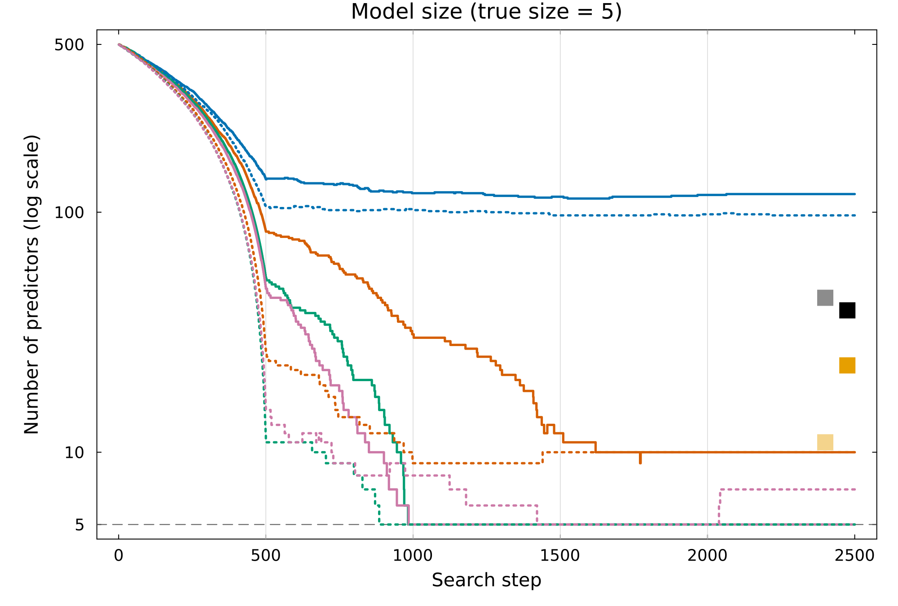</p>

<p align="center">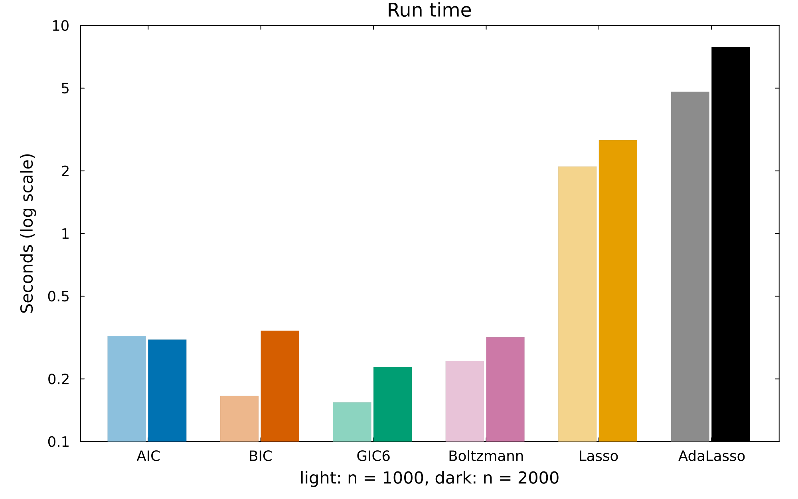</p>


### Multivariate normal

Five responses, each with its own 5 predictors and coefficients from 10
down to 0.1. Pass the $n \times 5$ response matrix as `Y`:

```julia
m = 5
B = zeros(p, m)
true_by_response = Vector{Vector{Int}}(undef, m)
for i in 1:m
    cols = sort(randperm(p)[1:5])
    true_by_response[i] = cols
    B[cols, i] = range(10, 0.1, length = 5)
end
Y_multi = LP_to_Y(X, B, "MultivariateNormal"; cov_matrix = Matrix(1.0I, m, m))
true_union = sort(unique(reduce(vcat, true_by_response)))

fits = compare_criteria(X, Y_multi, 1:p, p; Nsim = 5, lasso_family = MvNormal())
selection_table(fits, true_union)
#>                  size false_pos false_neg seconds
#> n1000 AIC          93        69         1    0.23
#> n1000 BIC          20         0         5    0.17
#> n1000 GIC6         20         0         5    0.29
#> n1000 Boltzmann    84        63         4    0.21
#> n1000 Lasso       132       107         0    5.48
#> n1000 AdaLasso     24         2         3    12.6
#> n2000 AIC          76        51         0    0.48
#> n2000 BIC          22         0         3    0.26
#> n2000 GIC6         20         0         5    0.27
#> n2000 Boltzmann   133       112         4    0.52
#> n2000 Lasso       131       106         0   10.14
#> n2000 AdaLasso     54        30         1   24.16
```

<p align="center">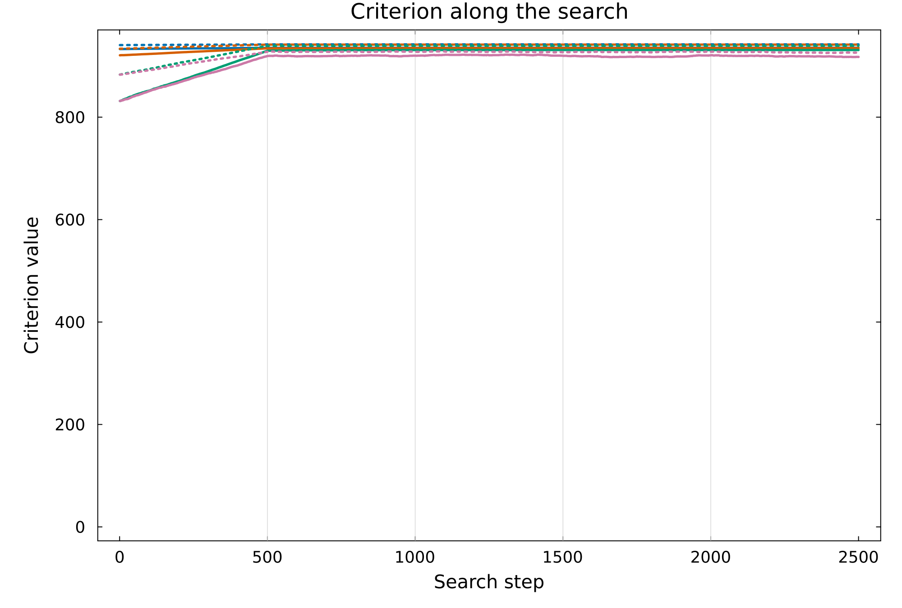</p>

<p align="center">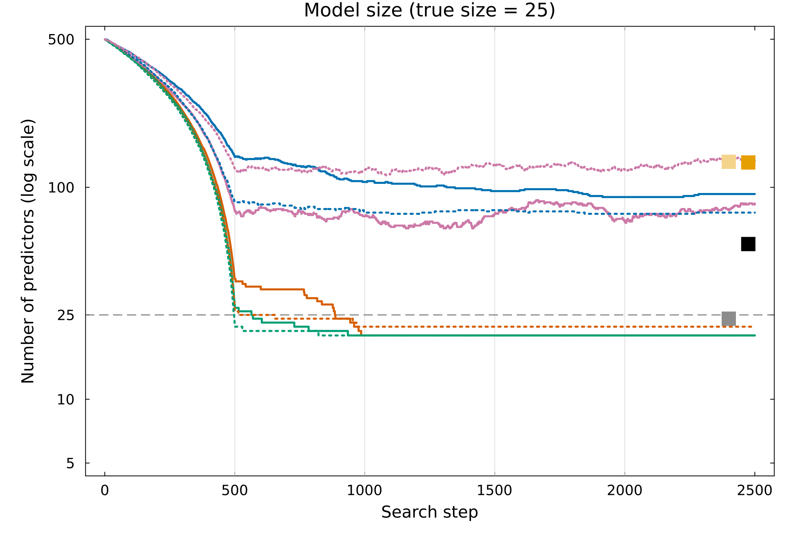</p>

<p align="center">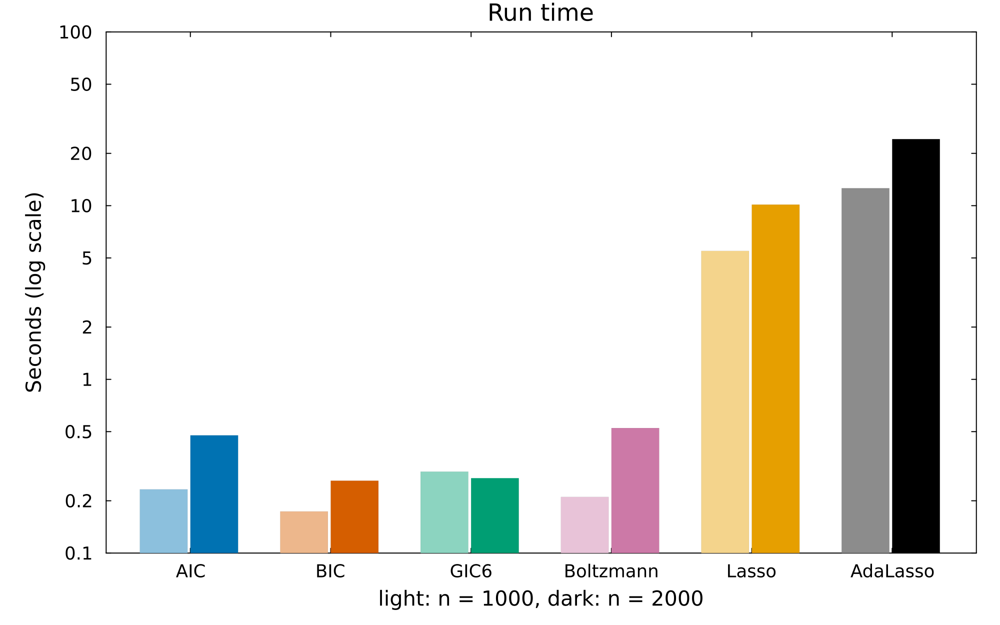</p>


### Generalized linear models

For a non-Gaussian response, map it to the linear-predictor scale with
`Y_to_LP()`, select with `GIC_Variable_Selection()`, and then fit the selected
model with `Beta_estimate()`. The GLM examples reuse the design matrix `X`
from above ($n = 2000$, $p = 500$), with 5 true predictors, and start each
search from the first 10 columns.

```julia
Random.seed!(2)
true_cols = [3, 17, 42, 88, 150]
beta = zeros(p); beta[true_cols] = [1, -1, 0.8, -0.8, 0.6]

# `y` is the response, `lasso_y` and `lasso_family` its form for GLMNet, and
# `family` and `kw` the family arguments for Y_to_LP()
compare_glm(y, lasso_y, lasso_family, family; kw...) =
    compare_criteria(X, Y_to_LP(y, family; kw...), 1:10, 50; Nsim = 3,
                     lasso_y = lasso_y, lasso_family = lasso_family)
```

#### Poisson regression

```julia
y_pois = LP_to_Y(X, beta, "Poisson")
fits = compare_glm(y_pois, y_pois, Poisson(), "Poisson")
selection_table(fits, true_cols)
#>                  size false_pos false_neg seconds
#> n1000 AIC          49        45         1    0.02
#> n1000 BIC           7         2         0    0.01
#> n1000 GIC6          5         0         0    0.01
#> n1000 Boltzmann    49        46         2    0.02
#> n1000 Lasso        24        19         0    5.73
#> n1000 AdaLasso      5         0         0    7.05
#> n2000 AIC          49        45         1     0.1
#> n2000 BIC           6         1         0    0.01
#> n2000 GIC6          5         0         0    0.01
#> n2000 Boltzmann    49        48         4    0.03
#> n2000 Lasso        28        23         0    4.72
#> n2000 AdaLasso      5         0         0   13.97

# Coefficients of the GIC6 model for n = 2000, intercept first
round.(Beta_estimate(y_pois, X[:, last_model(fits.n2000.GIC6)]; family = "Poisson"), digits = 2)
#> 6-element Vector{Float64}:
#>   0.01
#>   1.0
#>  -1.02
#>   0.78
#>  -0.8
#>   0.59
```

<p align="center">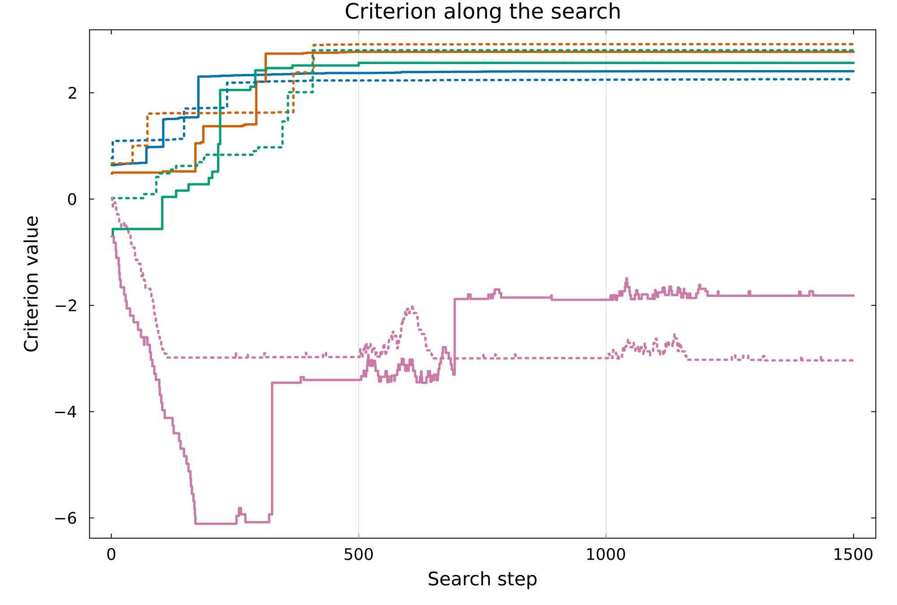</p>

<p align="center">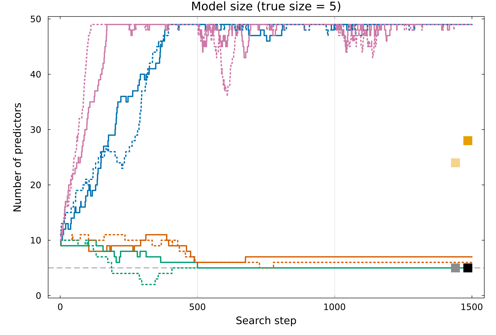</p>

<p align="center">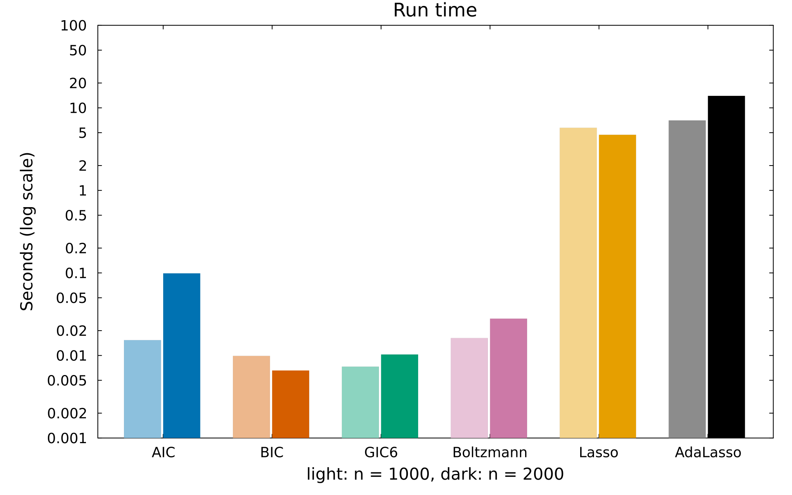</p>

#### Binomial counts (10 trials)

```julia
y_binom = LP_to_Y(X, beta, "Binomial"; n_trials = 10)
fits = compare_glm(y_binom, [10 .- y_binom y_binom], Binomial(), "Binomial"; n_trials = 10)
selection_table(fits, true_cols)
#>                  size false_pos false_neg seconds
#> n1000 AIC          49        46         2    0.01
#> n1000 BIC          10         5         0    0.02
#> n1000 GIC6          5         0         0     0.0
#> n1000 Boltzmann     5         0         0     0.0
#> n1000 Lasso        43        38         0    3.86
#> n1000 AdaLasso     46        41         0    7.31
#> n2000 AIC          49        47         3    0.07
#> n2000 BIC           8         3         0     0.1
#> n2000 GIC6          5         0         0    0.01
#> n2000 Boltzmann     5         0         0    0.01
#> n2000 Lasso        42        37         0    4.47
#> n2000 AdaLasso     77        72         0   13.34
```

<p align="center">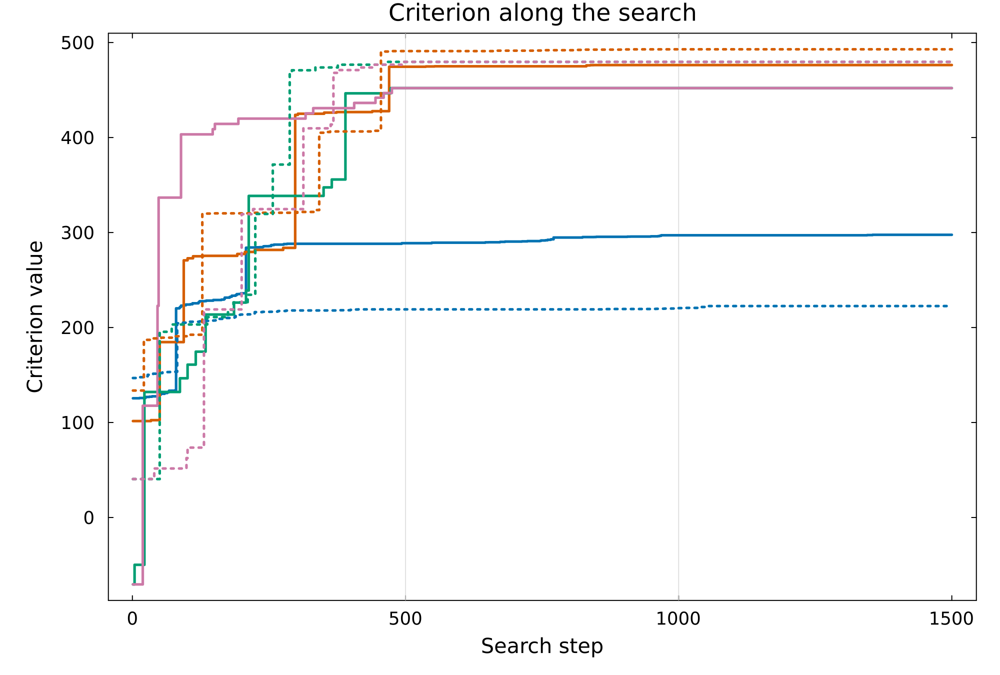</p>

<p align="center">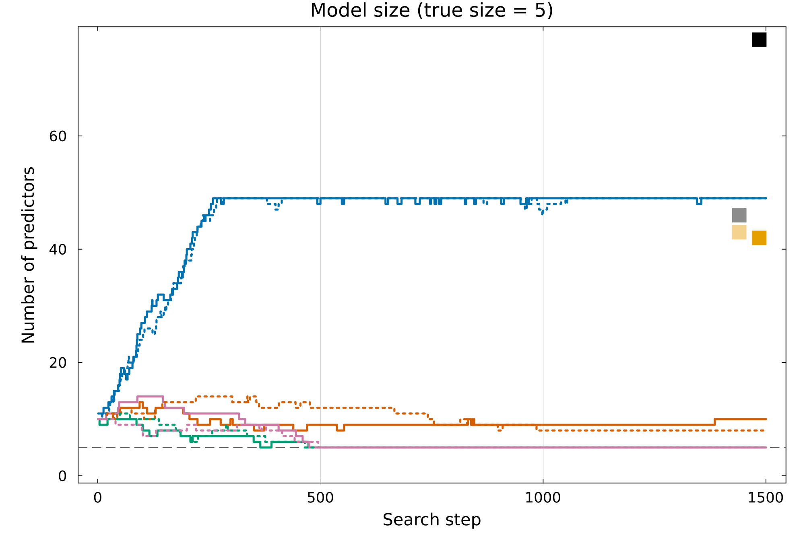</p>

<p align="center">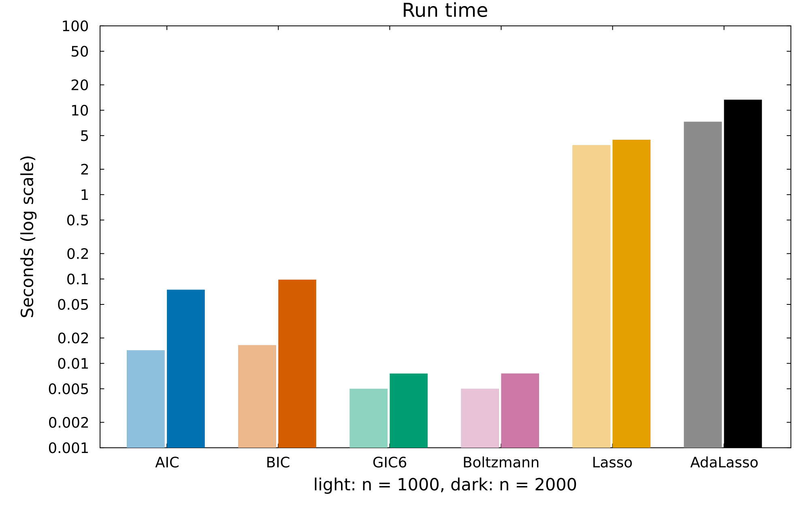</p>

#### Multinomial (three categories)

The coefficients form a $p \times 2$ matrix, and category 3 is the baseline:

```julia
B_mn = zeros(p, 2)
B_mn[true_cols, 1] .= 1.5
B_mn[true_cols, 2] = [-1.5, 1.5, -1.5, 1.5, -1.5]
y_mn = LP_to_Y(X, B_mn, "Multinomial"; n_categories = 3)
onehot = Float64[y == c for y in y_mn, c in 1:3]
fits = compare_glm(y_mn, onehot, Multinomial(), "Multinomial"; n_categories = 3)
selection_table(fits, true_cols)
#>                  size false_pos false_neg seconds
#> n1000 AIC          49        46         2    0.01
#> n1000 BIC           6         1         0    0.01
#> n1000 GIC6          5         0         0    0.01
#> n1000 Boltzmann     5         0         0     0.0
#> n1000 Lasso       101        96         0   13.95
#> n1000 AdaLasso     64        59         0   12.61
#> n2000 AIC          49        46         2    0.02
#> n2000 BIC           5         0         0    0.01
#> n2000 GIC6          5         0         0    0.01
#> n2000 Boltzmann    14         9         0    0.02
#> n2000 Lasso        87        82         0   29.04
#> n2000 AdaLasso     15        10         0   25.03
```

<p align="center">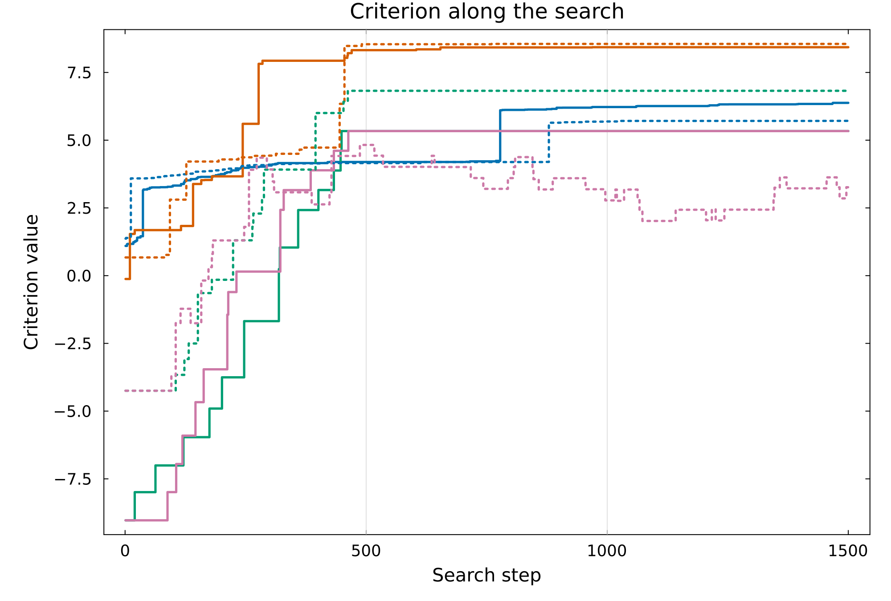</p>

<p align="center">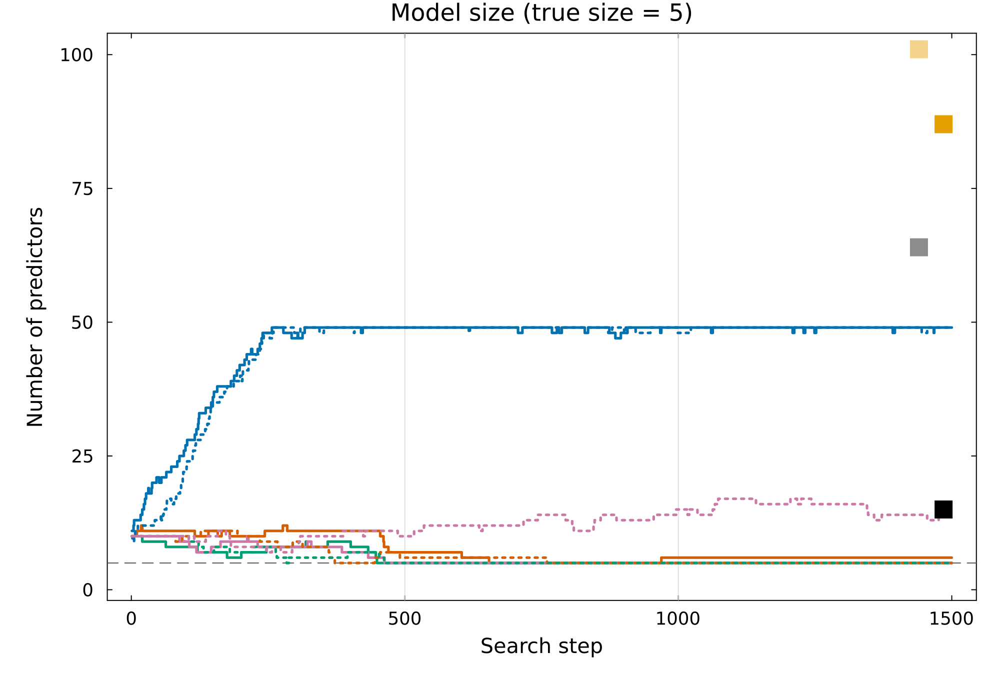</p>

<p align="center">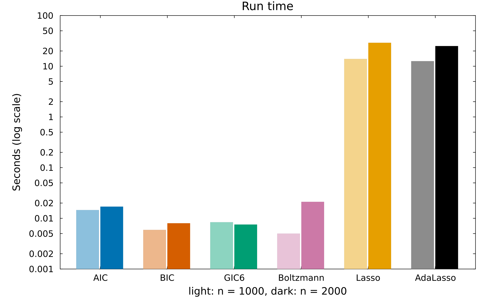</p>

## License

MIT License. See [`LICENSE`](LICENSE) for details.
